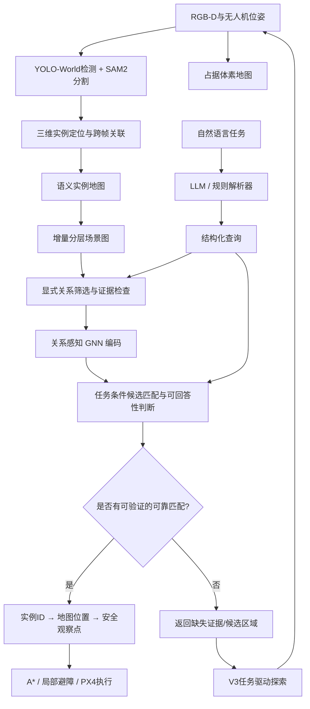
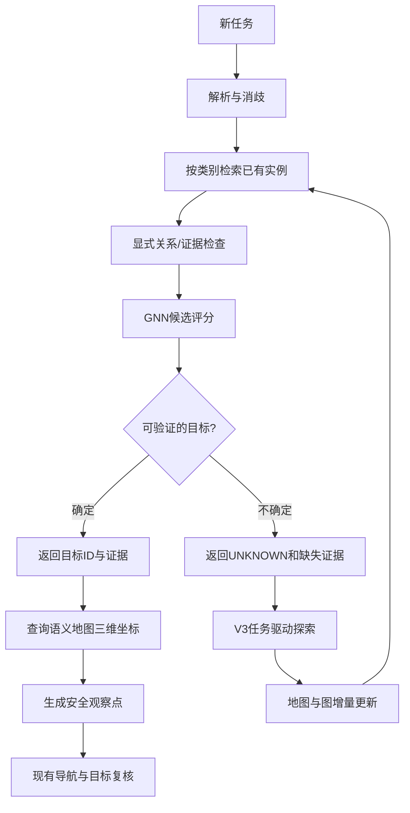

# V2：基于增量三维场景图的 GNN 语义关系推理——技术路线与训练实施方案

> 版本：v1.0（2026-10-13）  
> 适用项目：地下车库无人机 RGB-D 语义导航  
> 目标：在已有三维语义地图上，实现复杂自然语言关系查询、候选目标匹配和信息不足判定；为 V3 任务驱动探索提供接口。

## 1. 研究目标与边界

### 1.1 输入与输出

**输入：** 当前已构建或持续更新的场景图 $G_t=(V_t,E_t,X_t)$，以及结构化任务 $q$（后续由 LLM 从自然语言生成）。

**输出：** `resolved(target_instance_id, score, evidence)`、`ambiguous(candidates)` 或 `unresolved(missing_evidence)`。目标的三维坐标从语义地图按实例 ID 读取，而非要求 GNN 直接回归。

**边界：** GNN 不替代 YOLO-World + SAM2、RGB-D 三维重建、占据地图、A* 全局规划或局部避障。确定性的类别、几何距离、可通行性、方向约束应优先由规则验证；GNN 主要用于噪声和关系不完整条件下的上下文融合、候选排序。

### 1.2 总体技术路线



## 2. 场景图数据结构（V2.1）

### 2.1 节点

- **Object（物体实例）**：稳定实例 ID、类别及类别文本嵌入、三维中心、包围盒尺寸、朝向及其有效性、检测置信度、观测次数、视觉区域特征、观测时间。
- **Region（空间区域）**：区域 ID、中心/边界、区域类型、探索覆盖率、可通行属性。
- **Connector（可选的通道/路口）**：连接区域的通行点、空间位置和安全通过属性。

避免为每个体素创建 GNN 节点。体素地图继续用于精确几何规划，图层用于语义关系和区域级推理。

### 2.2 边和属性

| 关系 | 方向性 | 推荐生成方式 | 主要属性 |
|---|---|---|---|
| `near` | 可对称 | 欧氏或可达距离阈值 | distance, confidence |
| `inside` | 有向 | 实例中心与区域边界 | overlap, confidence |
| `connected_to` | 通常双向，必要时有向 | 区域拓扑/可通行性 | traversal_cost |
| `behind` | 有向 | 参考物体朝向局部坐标 | longitudinal_offset, orientation_valid |
| `left_of` | 有向 | 参考坐标系 | lateral_offset |
| `observed_from` | 有向 | 历史观测记录 | viewpoint, timestamp |

保存事实状态 `true / false / unknown`；缺失边不自动解释为关系为假。消息传递边还可包含“几何上相邻但关系未知”的候选边。

### 2.3 方位关系定义

对于 SUV 参考物体 $i$ 和候选物体 $j$：

$$\Delta p^{\mathrm{local}}_{ij}=R_i^T(p_j-p_i).$$

若约定 SUV 车头为局部 $+x$，则 $\Delta x^{\mathrm{local}}_{ij}<0$ 表示处于后方半空间。实际应增加车体宽度、距离及阈值约束；若 SUV 朝向未知，则关系状态应为 `unknown`，而不是断言 `behind=false`。用户语言中的“后方”须解析为车辆朝向、无人机视角或其他参考系。

### 2.4 示例存储接口

```json
{
  "map_id": "garage_001",
  "nodes": [
    {"id": "suv_01", "type": "object", "class": "SUV", "position": [2,3,0], "yaw": 0.0, "orientation_valid": true},
    {"id": "cab_02", "type": "object", "class": "fire_cabinet", "position": [0,3,1]},
    {"id": "exit_01", "type": "object", "class": "emergency_exit", "position": [1,4,0]}
  ],
  "edges": [
    {"src": "cab_02", "relation": "behind", "dst": "suv_01", "state": "true", "confidence": 0.92}
  ],
  "unobserved_regions": ["region_C"]
}
```

## 3. 自然语言任务解析（V2.1–V2.2）

第一阶段仅使用结构化查询，避免将语言解析错误和图推理错误混淆。后续再接入 LLM，并使用 JSON Schema 校验。

**自然语言示例：**“找到离安全出口最近、位于 SUV 后方的消防箱。”

```json
{
  "target_class": "fire_cabinet",
  "constraints": [
    {"relation": "behind", "reference_class": "SUV", "reference_frame": "vehicle_heading"}
  ],
  "ranking": {"metric": "euclidean_distance", "reference_class": "emergency_exit", "order": "ascending"},
  "scope": "observed_map"
}
```

**执行语义：**先筛选消防箱 → 按明确的 SUV 实例/量词解释后方关系 → 对满足约束的候选按安全出口距离排序。若存在多个 SUV/出口，必须在解析阶段规定“任意一个”“指定某个”“最近的一个”等语义，否则返回歧义。若用户要求整张未知地图的全局最近目标，必须单独验证探索覆盖是否足以支撑该结论。

## 4. GNN 网络架构（V2.3–V2.4）

### 4.1 特征编码

物体节点可采用：

$$x_i^{obj}=[\operatorname{Emb}(c_i),\ \tilde p_i,\ \tilde b_i,\ \psi_i,\ m_i^{ori},\ f_i^{vis},\ q_i]$$

其中 $m_i^{ori}$ 是朝向有效性掩码，$q_i$ 汇总观测可靠性。位置、尺寸需归一化；不同类型节点用专属编码器投影到统一隐藏维度 64 或 128。视觉特征可由 YOLO-World 中间区域特征、裁剪区域编码或文本嵌入获得；不能假设检测接口默认返回 DETR 风格 256 维特征。

对候选边：

$$e_{ij}=[p_j-p_i,\ \|p_j-p_i\|,\ \operatorname{Emb}(r_{ij}),\ q_{ij},\ m_{ij}].$$

### 4.2 消息传递

最小基线：两层 GraphSAGE。增强版：GATv2 + 边特征；异构版：HeteroConv / 关系感知 GAT 分关系聚合。关系感知注意力可以写作：

$$e_{ij}^{att}=a^T\mathrm{LeakyReLU}(W_sh_i+W_th_j+W_ee_{ij}),$$

$$\alpha_{ij}=\frac{\exp(e_{ij}^{att})}{\sum_{k\in\mathcal N(i)}\exp(e_{ik}^{att})},$$

$$h_i'=\sigma\left(\sum_{j\in\mathcal N(i)}\alpha_{ij}W_vh_j\right).$$

以上是**建议实现**，并非所讨论 CGI+GAIL 论文的原始网络公式。二层 GNN 只能直接传递有限跳数关系，长距离关系可引入区域层级、全局读出或额外图推理机制。

### 4.3 查询条件匹配

令查询编码为 $z_q$，候选集合为 $C(q)$，将显式可验证几何特征 $g_i$ 一并提供：

$$s_i=\mathrm{MLP}([h_i\Vert z_q\Vert g_i]),\quad i\in C(q).$$

候选分布：

$$P(i\mid G,q)=\frac{\exp(s_i)}{\sum_{j\in C(q)}\exp(s_j)}.$$

增加 `UNKNOWN` / `INSUFFICIENT_EVIDENCE` 作为额外输出。但严格的几何、关系、覆盖检查必须在最终执行前复核，不能把 Softmax 最大值当作真实置信度或全局最优保证。

## 5. 自动训练数据生成（V2.2）

### 5.1 数据来源

- **仿真真值层**：UE 物体真实类别、实例 ID、位置、姿态、区域归属、可通行拓扑；仅用于自动标签生成和评估。
- **观测输入层**：真实模拟飞行时 RGB-D 检测、跨帧融合后的实例地图和局部场景图；模型训练输入应尽可能来自这一层，避免仿真真值直接泄漏。

### 5.2 每条样本格式

$$D_k=(G_k,q_k,C_k,y_k,o_k).$$

- $G_k$：完整或部分场景图。
- $q_k$：结构化关系查询。
- $C_k$：查询类别过滤后的候选节点。
- $y_k$：唯一目标在候选集内的索引；若无充分证据则为 `UNKNOWN`。
- $o_k$：证据状态和原因（未发现参考物、朝向未知、区域未覆盖、候选并列等）。

### 5.3 样本类型

1. **A：完整图、简单关系**：`behind`、`near`、`inside`；验证基本学习流程。
2. **B：完整图、组合关系**：区域归属 + 朝向 + 目标排序 + 多跳拓扑；设置距离接近的困难负样本。
3. **C：部分图、观测噪声**：从真实探索轨迹采样，保留漏检、姿态误差、关系未知、实例合并错误等情况；训练拒识和鲁棒性。

训练/验证/测试按**车库布局**拆分，同一车库的不同探索时刻与查询不能同时散落在训练集和测试集。固定随机种子、记录地图配置、对象数量、任务模板和样本来源。

### 5.4 防止标签泄漏

若训练目标是预测 `behind`，不要把对应待预测关系直接作为已知真值边输入。可以输入原始几何/有噪声关系候选并隐藏目标关系；同时必须用明确规则查询作为强基线。只有在困难场景、关系缺失或视觉语义歧义等情况下表现改善，才可说明 GNN 的增量价值。

## 6. 损失函数与训练机制（V2.3）

对于**唯一正确目标**样本：

$$\mathcal L_{target}=-\log P(y\mid G,q).$$

对于可回答性，推荐先以单独二分类头预测：

$$\mathcal L_{ans}=\operatorname{BCE}(\hat a,a),$$

其中 $a\in\{0,1\}$ 表示现有证据是否足以判定。也可将 `UNKNOWN` 放入候选 softmax，但必须在无候选实例的情况下仍能正确训练，并为不同样本处理候选集合长度。

可选：监督关系预测损失 $\mathcal L_{rel}$，但其评价集应与输入关系边隔离。

$$\mathcal L=\mathcal L_{target}+\lambda_{ans}\mathcal L_{ans}+\lambda_{rel}\mathcal L_{rel}.$$

建议先仅用 $\mathcal L_{target}$ 建立基线，再逐项加入其他任务并做消融。若样本 `UNKNOWN`，不应强行计算目标交叉熵到某个并不存在的正确实例。

### 6.1 单次训练迭代

1. 读取一张场景图、结构化任务和标签。
2. 节点/边编码与 GNN 前向传播，得到节点嵌入 $H$。
3. 对当前任务的候选节点打分，输出可回答性。
4. 分别计算可用标签对应的目标损失、可回答性损失。
5. `zero_grad()` → `backward()` → `optimizer.step()`，更新节点编码器、GNN、匹配头等可训练参数。
6. 验证时不更新权重，按未见布局测评。

```python
# 伪代码：展示关键训练机制，非可直接运行的完整工程
for sample in train_loader:
    graph, query, candidates, label, answerable = sample
    H = gnn(node_encoder(graph.x), graph.edge_index, graph.edge_attr)
    q = query_encoder(query)
    scores = matcher(H[candidates], q)
    ans_logit = answerability_head(H, q, graph.meta)

    loss = bce_with_logits(ans_logit, answerable)
    if answerable and len(candidates) > 0:
        loss = loss + cross_entropy(scores.unsqueeze(0), label.unsqueeze(0))

    optimizer.zero_grad()
    loss.backward()
    optimizer.step()
```

推荐实验起点：隐藏维度 64、2 层 GNN、AdamW、学习率 $10^{-3}$、批大小按图规模调节、早停和验证集选模。具体参数均需通过实验确定。

## 7. 在线推理与导航接口（V2.5）



**建议接口：**

```json
{
  "query_id": "task_002",
  "status": "resolved",
  "target_instance_id": "cab_02",
  "candidate_scores": [{"id": "cab_02", "score": 0.91}],
  "evidence": {"reference_suv": "suv_01", "reference_exit": "exit_01", "behind_verified": true},
  "map_version": 42
}
```

状态建议：`resolved` / `ambiguous` / `unresolved` / `not_found_in_observed_map`；避免把“当前地图未发现”错误地解释为“整个环境不存在”。

## 8. 实验与评价

| 实验组 | 输入 | 作用 |
|---|---|---|
| 几何/拓扑规则 | 精确位置+显式事实 | 强基线 |
| MLP | 节点本身+查询 | 检验是否需要邻居消息 |
| GraphSAGE | 节点+连接 | 初始 GNN 基线 |
| GATv2 + Edge | 节点+几何边特征 | 测试关系注意力 |
| HeteroGNN | 实例+区域+多关系 | 测试分层结构价值 |
| GNN + Partial-Graph | 加入部分观测/噪声 | 测试鲁棒性和拒识 |

**指标：** Top-1 Accuracy、Recall@K、Macro-F1（可回答性）、UNKNOWN AUROC/AUPRC、错误肯定率、校准误差、查询延迟、导航成功率、未见场景泛化。对精确“最近”约束分别报告已知地图最优和全局真值最优，避免概念混淆。

**消融：** 去掉区域节点、删除边特征、移除视觉嵌入、移除朝向有效标志、移除拒识训练、改变可见覆盖率/定位噪声。

## 9. 开发里程碑与验收

| 阶段 | 交付物 | 验收条件 |
|---|---|---|
| V2.1 图构建 | `scene_graph_builder.py`、图数据规范 | 同一实例多帧归并，边语义及方向一致，图可序列化 |
| V2.2 自动标注 | `generate_queries.py`、样本 manifest | 真值标签可复算；按场景严格隔离训练与测试 |
| V2.3 基础训练 | `train_gnn.py`、基础模型及日志 | 训练收敛；优于随机，和规则/MLP 完成对比 |
| V2.4 复杂推理 | 多关系、部分图、拒识 | 未见场景上测量准确率/拒识指标；完成消融 |
| V2.5 系统集成 | 查询 API + 导航接口 | 查询 → 目标ID → 观察点 → 导航闭环成功；失败可返回证据原因 |

### 推荐工程目录

```text
semantic_graph/
  schemas.py
  scene_graph_builder.py
  relation_geometry.py
  graph_export.py
  query_parser.py
  query_validator.py
  datasets/
    generate_queries.py
    partial_graph_sampler.py
    scene_split.py
  models/
    node_encoder.py
    graph_encoder.py
    query_encoder.py
    target_matcher.py
  train_gnn.py
  evaluate_gnn.py
  inference.py
  tests/
    test_coordinate_relations.py
    test_graph_integrity.py
    test_query_labels.py
    test_unknown_cases.py
```

## 10. 与参考论文的联系及区别

参考论文：Meng et al., *Context-Aware Graph Inference and Generative Adversarial Imitation Learning for Object-Goal Navigation in Unfamiliar Environment*, IEEE RA-L, 2025，DOI: 10.1109/LRA.2025.3546860。

论文使用 DETR 物体特征构建全连接图，并通过图像、动作、记忆三种上下文计算动态关系权重，随后 GAT 与视觉特征融合以训练导航策略。**本方案属于项目化扩展，不是该论文的复现：**使用已建三维语义实例/区域图、显式几何和拓扑关系、目标 ID 监督训练以及不完整地图的可回答性判定；底层运动规划继续使用已有模块。

## 11. 最小可行实验（优先实施）

1. 选用 3–5 套不同 UE 车库布局，各放置多个 SUV、出口、消防箱，统一保存真值和检测融合后的图。
2. 定义三个任务模板：`near`、`behind`、`inside+near`；提前严格规定坐标系和歧义处理。
3. 自动生成 `(图, 查询, 候选集, 正确ID)`；使用按场景隔离的验证集。
4. 首先实现精确规则系统，确定标签、规则和输入数据管线无误。
5. 训练 MLP、GraphSAGE、GATv2；比较未见布局中的目标检索准确率。
6. 添加真实探索前缀图，形成 UNKNOWN 样本，训练可回答性预测。
7. 接入已保存地图的查询 API，完成目标实例 ID → 安全观察点 → 规划与导航闭环。

**关键判断标准：** 若在高质量完整地图上规则方法已接近完美，不应以 GNN 替代规则作为“改进”；应将研究重点转向不完整观测、噪声关系、多跳语义和不确定性下的鲁棒目标查询。
