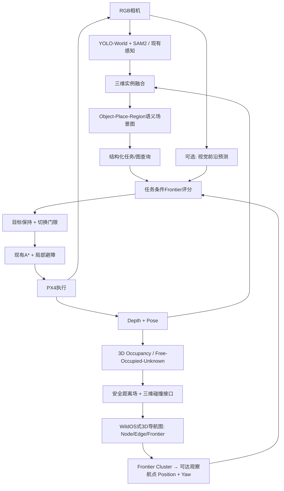
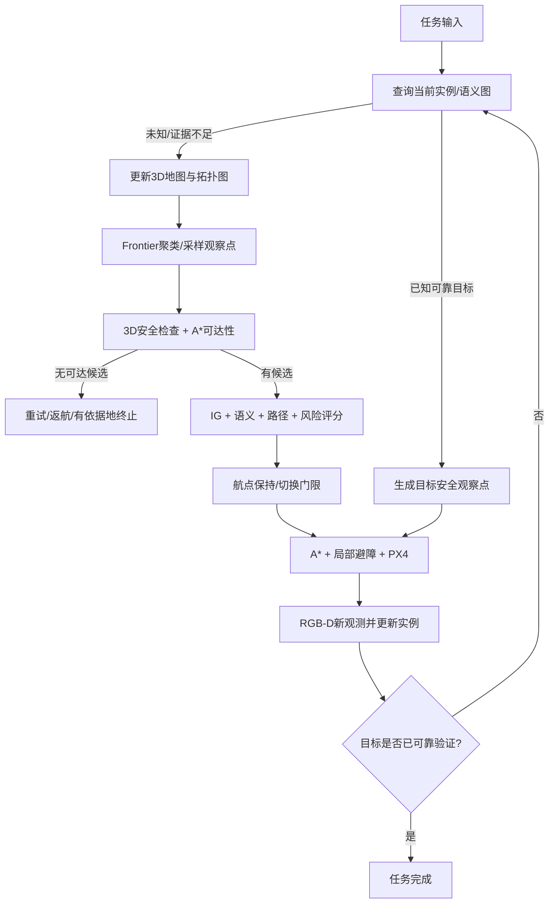

# WildOS × 地下车库无人机：从现有工程到任务驱动语义探索的逐步实施指南

> 文档性质：工程落地路线、算法选择与分阶段验收手册  
> 版本：1.0 · 2026-11-02  
> 研究对象：RflySim / UE 地下车库、PX4 单无人机、RGB-D + 位姿、YOLO-World + SAM2、占据体素地图、A* 与局部避障  
> 核心原则：**不推倒现有工程；先几何拓扑、再语义评分、再复杂任务与GNN；几何安全永远由现有地图/规划器复核。**

## 0. 本文使用说明与方法来源

**[原论文]** 表示 WildOS: *Open-Vocabulary Object Search in the Wild*（上传的 2026-02-22 arXiv v1）明确提出的算法。  
**[适配]** 表示为了让方案适用于三维室内无人机而新增或修改的步骤。  
**[已有]** 表示当前项目已有功能的计划复用入口，**不代表已经检查过仓库或确认具体函数名**。  
**[可选]** 表示需要前面阶段验证完成后再考虑的研究扩展。

原论文主要采用地面机器人的**二维/2.5D局部几何可通行图**，使用：①稀疏导航图+空间记忆，②ExploRFM图像可通行/视觉前沿/目标相似度，③多视角目标粗定位，④跨模态Frontier评分，⑤高层图规划+局部安全导航。本实施计划将其迁移到三维地下车库；保留你已有的视觉识别、三维占据图、导航及控制系统。

### 0.1 目标与非目标

**近期可验证目标（MVP）**：无人机在未知车库中边建图边维护稀疏三维导航图，自动发现有效Frontier、生成安全观察航点并交给现有A*执行；引入任务相关评分后，比单纯最近Frontier更快发现指定目标，且不会明显增加碰撞或航点切换。

**后续研究目标**：目标已记录时利用Object–Place–Region场景图直接检索；未记录或证据不足时选择有语义价值的Frontier；支持复杂关系如“找到距离安全出口最近、位于SUV后方的消防箱”，并在证据不足时拒绝过度确定的答案。

**本阶段不做**：将GNN直接连接PX4输出控制量；把图像视觉可通行概率当三维无碰撞证明；把一切未观测空间标记为可飞；完全重写现有A*/局部避障/PX4模块；把原论文二维评价参数无条件应用到无人机。

### 0.2 最终数据流



---

# 第一部分：先把几何导航图做成可靠的工程模块（P0–P5）

## P0. 工程现状核查与统一接口（必须先完成）

### 要做什么

1. 阅读现有代码，定位：RGB/Depth/Pose同步、三维占据更新、FREE/OCCUPIED/UNKNOWN查询、Frontier检测、候选航点生成、A*碰撞检测、局部轨迹执行、HTML/Open3D地图导出。
2. 建立一个**只读地图快照接口**，不依赖实时UE/PX4就能在离线环境复现一次探索图更新。
3. 固定地图坐标系（例如现有NED世界系）、相机外参、深度单位、体素分辨率、时间戳约定。
4. 固定机体安全近似（先用包围球；后续可用包围盒/扫掠体）；明确安全裕度和允许的飞行高度范围。
5. 编写“现有接口→新增模块”的适配表，不要凭空假定已有方法名称。

### 方法/工具

- 使用现有体素地图的查询API；若无距离场，离线小范围可用 `scipy.ndimage.distance_transform_edt` 验证原型，在线大场景可考虑增量ESDF实现；**距离场不能绕过UNKNOWN判定**。
- 数据快照建议：`map_meta.json`、`occupancy.npz`、`pose.json`、`instances.json`、`camera_calibration.json`、`frontier_candidates.json`。
- 使用`pytest`写坐标转换、体素索引、地图读写回归测试。

### 输入→输出

| 输入 | 输出 |
|---|---|
| 当前/历史占据地图、位姿、实例地图、相机参数 | 统一地图快照、Adapter接口清单、坐标与安全约定 |

### 验收标准

- 离线读取一份地图快照，查询任意三维位置的FREE/OCCUPIED/UNKNOWN状态，与实时地图一致。
- 同一SUV或消防箱在地图可视化与实例记录中的世界坐标一致。
- A*与拓扑图使用同一套障碍膨胀及飞行安全约束。

**Codex工作包 P0**：仅审查接口并生成适配器、地图快照和测试，不修改已有感知、PX4、控制器。

## P1. 3D SDF/ESDF与节点安全判定

### 论文原理

WildOS Algorithm 1先计算到障碍物、到UNKNOWN区域的两个距离场；Algorithm 2按下式更新节点自由半径：

\[
 r_i^f = \min\left(D_{obs}(p_i), D_{unk}(p_i), r_{max}^f\right).
\]

其中Free Radius由最近障碍、未知边界及最大半径共同约束。

### 三维无人机如何适配

1. 从三值体素图分别生成到已知障碍物与UNKNOWN的距离查询：`distance_to_obstacle(p)`、`distance_to_unknown(p)`。
2. 计算机体安全间隙：`r_safe = r_body + safety_margin`（参数化）。
3. 对三维候选位置p要求：`occupancy(p)==FREE` 且 `min(D_obs(p),D_unk(p)) > r_safe`。
4. 对边/轨迹执行**机体扫掠碰撞检查**：从p到q对线段按足够密的步长采样，结合膨胀障碍/ESDF检查整个运动包络；不能只检查端点。
5. 检查顶棚、横梁、柱子、车辆上方、斜坡、边界和地图未知区域。

### 易错点

- `SDF_unk`不能由“未出现在稀疏字典中的体素自动当free”得到。
- NED的高度方向与图像坐标不同，位置变换必须有测试。
- **Free Radius是局部几何安全近似，不代表PX4轨迹动力学可行**。

### 输出与验收

交付 `occupancy_adapter.py`、`distance_field_adapter.py`、`collision_check_3d.py`；在窄门、车顶、横梁下方分别验证安全边界。必须不存在边穿过OCCUPIED/UNKNOWN的案例。

## P2. 参考WildOS Algorithm 2维护已有导航节点

### 节点结构（第一版）

```python
@dataclass
class NavNode:
    node_id: int
    xyz_world: tuple[float, float, float]
    free_radius: float
    explored_radius: float
    is_frontier: bool
    frontier_point_ids: list[int]
    visit_count: int
    map_version: int
```

### 要做什么

1. 读取上一时刻图`G_(t-1)`和最新三维局部地图。
2. 对位于当前地图可验证范围内的旧节点重新计算`free_radius`：`min(D_obs,D_unk,r_free_max)`。
3. 更新`explored_radius = max(previous, D_unk)`，这是**原论文的持久历史半径近似**。
4. 当旧节点进入确知OCCUPIED或者不满足无人机安全条件时，标记失效并删除/禁用其连接边。
5. 若地图增量更新使一条旧边路径被新障碍占据，即使两个端点都合法，也应使该边失效并重新验证。
6. 保存`map_version`和被影响的节点/边列表，尽量局部更新。

**特别提醒**：WildOS中的圆形Explored Radius不能准确表示有遮挡的车库空间。建议同时保留`observed_voxel_mask / last_seen / visit_count`，后面删Frontier时用真实观测状态复核，不直接用球形覆盖“证明”视野中所有空间已被观测。

**验收**：地图更新时旧节点ID保持稳定；新增障碍后边自动失效；日志中出现`nodes_updated/nodes_invalidated/edges_invalidated`统计。

## P3. 参考WildOS Algorithm 3采样新导航节点

### 原论文采样条件

\[
p_{rand}\sim\operatorname{Uniform}(FreeRegion),
\]

\[
\min(D_{obs}(p_{rand}),D_{unk}(p_{rand}))>r_{trav},
\]

\[
\forall v_j\in V_{t-1},\quad \|p_{rand}-p_j\|>r_j^f.
\]

这里第三条的意义是控制冗余采样，并不是规定相邻节点之间一定不能连接。

### 具体实现

1. 仅在三维**已知安全FREE**空间采样（参数`max_samples_per_update`）。
2. 初版推荐**高度分层采样**：根据飞行允许高度建立几个可配置的候选层；每层采样自由体素，再允许跨层连边。避免把高度层固定为不可变规则。
3. 每个候选点执行P1安全性检查。
4. 查询已有节点及本轮**已经接受的新节点**，若新点被其他节点的自由空间球覆盖则拒绝，以减少单轮重复采样（后者是工程加强）。
5. 对狭窄通道、交叉口、转角额外允许补充采样，避免开阔地采样过多、关键连接位置没有节点。
6. 使用KDTree/空间哈希做邻居搜索；设置每轮采样上限、更新耗时上限。

### 交付与验收

`node_sampler_3d.py`，输出新增点列表及`reject_reason`（障碍、未知、净空不足、冗余、越界）。能在两侧有车、上方有梁的窄道形成连通节点，而不是只有开阔区域有节点。

## P4. 参考WildOS Algorithm 4维护三维Frontier

### 重要概念区分

- **Frontier voxel**：FREE邻接UNKNOWN的三维体素/边界面单元。
- **Frontier cluster**：空间相近、可合并处理的一组Frontier体素。
- **Frontier nav node**：一个**安全自由空间中的导航节点**，因为关联了Frontier而被标记为探索候选节点。
- **Viewpoint / 观察航点**：最终可以执行的`(x,y,z,yaw)`；**不应直接设为UNKNOWN体素中心**。

### 按原论文三部分实现

**A. 清理历史Frontier**：读取旧节点关联的Frontier点；如果点已变Known或超出当前有效地图可检查范围，按明确规则更新其有效性。注意：局部地图暂时不可见，不应自动判定全局Frontier已失效。

**B. 更新节点标志**：节点仍有有效Frontier点则`is_frontier=True`，否则为False；节点本身不一定删除。

**C. 发现新Frontier并关联**：

1. 从FREE和UNKNOWN的6邻域交界提取Frontier体素。
2. 对Frontier体素进行三维连通分量聚类；过滤极小噪声簇。
3. 参考论文的`explored_radius`做冗余候选初筛，**再用观测掩膜/射线可见性判断是否应跳过**。
4. 对每个有效Frontier，寻找距离最近且连线满足三维无碰撞条件的导航节点。
5. 将Frontier点ID关联到该NavNode，更新`is_frontier`。

论文Algorithm 4选择的是最近的无碰撞可连接节点，不是把每个Frontier点都变成导航节点。

### 验收

Robot向前飞行后，旧边界随着UNKNOWN变为Known被清除，新边界出现在更远处；对被SUV遮挡但仍为UNKNOWN的区域不应因“球形已探索半径”错误删除全部Frontier。

## P5. 参考WildOS Algorithm 5连接导航图边

### 原论文规则

对每个节点`v_i`，通过`GETSPATIALNEIGHBORS(v_i,V,r_edge)`寻找邻居；若`CollisionFree(v_i,v_j)`，则新增边`(v_i,v_j)`。

### 三维实施

1. 用KDTree或空间哈希搜索`r_edge`范围内的候选节点对。
2. 使用P1的三维扫掠碰撞接口验证整段连接。
3. 若跨高度层，要求连接路径的每个中间位置满足安全性；不能只看x-y投影。
4. 边属性至少包括`length_3d`、`min_clearance`、`map_version`、`last_validated_at`、`is_valid`。
5. 若图作为高层路径参考，还可存`estimated_navigation_cost`，但所有最终路径仍交现有A*验证。
6. 增量地图更新时重新验证受影响的旧边，删除失效边；**这是工程安全加强**，原Algorithm 1的集合并入式更新不能直接保证旧边持续有效。

### 验收

在有柱子、墙、SUV顶棚遮挡的地图中，任何绘制出的有效边都不穿过障碍/UNKNOWN；图的连通分量与三维A*的实际可达性基本一致，误差案例可定位到具体边。

---

# 第二部分：真正把拓扑Frontier变成无人机可执行的探索（P6–P8）

## P6. 生成“安全观察航点”：WildOS地面方法之外的必要改造

### 为什么需要独立模块

WildOS的Frontier是拓扑图的高层候选。无人机执行前还必须满足相机视场、视角、飞行高度、安全净空和可达轨迹约束。

### 逐项执行

1. 对每个Frontier cluster计算几何中心、边界法向候选方向、大小、距当前机体的粗略距离。
2. 沿未知区域朝向的**已知FREE侧**采样若干安全观察位置，覆盖多个半径和高度。
3. 对每个位置生成候选Yaw：让相机主光轴大致朝向Frontier（必须使用真实相机-机体外参）；必要时使用多个Yaw扇区。
4. 用相机内参、FOV、最大/有效深度、射线投射估算该姿态能看到的UNKNOWN体素数，作为`expected_information_gain`。
5. 过滤：视点已知FREE、满足机体净空、姿态可执行、相机视场覆盖足够、A*可达、预估轨迹安全。
6. 对每个Frontier保留Top-K有效视点，同时记录选择失败原因。
7. 若没有可用视点，标记该Frontier暂不可执行，等待地图更新或换角度，不要把失败航点反复提交给PX4。

### 信息增益计算（推荐首版）

\[
IG(v,\psi)=\sum_{u\in\mathcal U_{visible}(v,\psi)}w(u)
\]

对视点`v`和Yaw`ψ`，按相机视锥射线遍历，统计有机会被新观测的UNKNOWN体素；遮挡体素后方不能无条件计入。第一版令`w(u)=1`，后续加入距离/目标相关权重。

**交付**：`viewpoint_generator.py`，包含`position, yaw, frontier_id, predicted_gain, clearance, path_cost, validity_reason`。

## P7. 将高层拓扑图和现有A*、局部避障接通

1. 将P6输出视点提交**已有A***，禁止开发一套平行的低层规划器。
2. 约定统一调用：`plan(start_pose, goal_pose)`及响应状态`SUCCESS/UNREACHABLE/INVALID/STALE_MAP`（名称由实际代码决定）。
3. 规划成功后交给现有轨迹生成、局部避障和PX4执行模块。
4. 过程中持续检查路径失效、定位变化、障碍更新与目标完成。
5. 实现导航结果回执：`reached / failed / replanned / emergency_stop`及实际飞行距离、耗时。
6. 到达观察点后更新地图，重新运行P1–P5，然后判断继续探索或结束。

**验收**：不使用视觉语义评分，仅最近有效Frontier/最大IG即可闭环探索；原有安全功能不退化。

## P8. 航点稳定与终止条件（建议与P7同步实现）

### 航点保持机制

- 当前目标仍有效时，保留目标至少一个合理执行窗口；只在到达、失效、明显更优目标出现、持续无信息增益或安全事件时重选。
- 切换条件示例：`U_new > U_current + delta_switch`，并设置最短保持时间/路径进度阈值；参数需测试确定。
- 避免每张图像或每个体素更新都直接触发PX4任务切换。

### 终止条件分层

| 条件 | 说明 |
|---|---|
| 目标任务完成 | 目标可靠识别并已到达验证观察点 |
| Frontier耗尽 | 没有**有效且可达**Frontier，且连续多轮更新无新增 |
| 信息增益不足 | Top候选预计IG长期低于阈值 |
| 时间/电量预算 | 触发安全返航或任务暂停 |
| 不可达/异常 | 所有候选不可达、定位异常或安全保护触发 |

**未知车库不可能轻易证明100%覆盖。** 报告“当前传感与可达空间下的探索结束”，而不是无依据声称地图完整。

---

# 第三部分：WildOS的视觉语义能力怎样适配车库（P9–P11）

## P9. 目标识别分支：先复用YOLO-World + SAM2

**[原论文]** ExploRFM使用RADIO视觉骨干、文本对齐特征和SigLIP-2文本编码计算目标相似度掩膜。  
**[适配]** 你已有开放词汇检测和SAM2分割，不必为了完成MVP整体替换视觉模型。

具体步骤：

1. 输入当前结构化目标类别（如`SUV`、`fire_cabinet`、`emergency_exit`）。
2. 将目标描述传给现有YOLO-World检测，再用SAM2获取掩膜。
3. 结合深度/位姿生成或更新三维Object实例；保存实例ID、观测次数、类别置信度、位置/朝向有效性。
4. 输出两个分离结果：`known_object_instances`（已可靠定位）和`image_level_candidates`（图像中有疑似目标但三维定位不足）。
5. 若已可靠定位：进入目标观察点规划；否则继续Frontier探索。

**不要混淆**：YOLO检测置信度不能直接当WildOS的RADIO图文余弦相似度。可以统一接口，但在记录中标记`score_source`。

## P10. Visual Frontier：先规则/弱监督，再训练专用视觉头

### 研究动机

地下车库的柱子、墙角、两排车辆之间的通道，可能形成有价值的视觉延伸方向。注意：这提供的是探索**线索**，不是可飞行安全保证。

### P10-A 无学习版本（推荐先做）

1. 将P4生成的几何Frontier节点/候选视点用相机位姿投影到当前RGB图像。
2. 剔除位于相机后方、出界、被已知障碍挡住或投影不可置信的点。
3. 在投影点附近计算可见空隙程度、深度变化、UNKNOWN边界投影、车道/柱子/停车区域上下文等启发式指标。
4. 生成`visual_frontier_score`并标记证据来源。
5. 只把该分数用于候选排序，不允许绕过P1/P6/P7安全检查。

### P10-B 可学习版本（后续）

1. 从UE和真实/仿真车库采集RGB帧及对应位姿、探索前缀地图。
2. 规定视觉前沿标注准则：图像中可引导下一步**有信息增益观测**的通道/转角/遮挡后未知边界；需人工复核。
3. 先使用可控的局部视觉骨干特征+轻量上采样CNN预测`F_vis ∈ [0,1]^{H×W}`；可参考ExploRFM结构，但不宣称已复现RADIO训练。
4. 用加权BCE/Dice等损失处理正负像素不均衡，按**车库布局**划分训练/验证/测试。
5. 验证：像素级PR/F1只是辅助；最终以目标发现时间、无效前沿比例、闭环探索性能为准。

**重要限制**：WildOS的“视觉可通行性”训练针对地面，不能直接当无人机三维飞行通道分割器；建议将该分支重新定义为视觉可探索性/未知通道提示，并始终让几何模块保证安全。

## P11. 任务相关Frontier评分（先可解释融合，再复现WildOS评分）

### P11-A MVP实用评分

\[
U(v)=w_{IG}\widetilde{IG}(v)+w_{sem}S_{sem}(v)-w_{path}\widetilde C_{A*}(v)-w_{risk}R(v)-w_{revisit}P(v).
\]

`~`表示归一化，不同量纲需做归一化和权重消融。

计算顺序：

1. 从P6收集所有可执行视点；不合法直接过滤。
2. 使用已有A*得到**真实可达路径代价**，不能仅用欧氏距离代替。
3. 从视锥射线估算`IG`。
4. 根据当前查询和已知Object/Region信息计算`S_sem`（首版可使用规则先验）。
5. 根据净空/障碍/高度变化定义`R`；根据访问历史定义`P_revisit`。
6. 输出每项原始分、归一化分、综合分，以及可解释的选择原因。
7. 提交P8目标保持模块后，才允许更新高层航点。

### P11-B 对照复现WildOS式跨模态项

WildOS将几何Frontier投影到图像，组合`Goal Confidence × Reachability Confidence × Frontier Confidence`：

\[
s_i=\max_{p\in\mathcal X}G_{conf}(p)R_{conf}(p)F_{conf}(p).
\]

论文还区分几何深度视野`H_d`与视觉视野`H_v`，并用图像上的最小代价路径估计`R_conf`；其方向评分缓存可以被任务方向重复使用。**无人机适配时**：`R_conf`只能作为视觉线索，真实3D安全性必须由A*/碰撞检测判定。

### 评分对照验收

固定同一张导航图、同一组候选视点，比较：最近Frontier / IG+路径 / P11-A / P11-B。必须记录真实执行结果，不能只展示“热力图看起来更合理”。

---

# 第四部分：语义场景图、复杂关系查询与GNN（P12–P14）

## P12. 将Object–Place–Region与导航图关联

**[适配，来自你的GNN V2方向，不是WildOS原论文自带五层DSG]**

### 最小图结构

- `Object`：SUV、消防箱、安全出口、轿车，保存稳定实例ID、类别、三维中心/包围盒、有效朝向、置信度。
- `Place`：P2–P5产生的安全自由空间拓扑节点。
- `Region`：停车区、主车道、坡道、出入口等功能区；初期可用UE区域标注做开发真值，但正式系统需实现自动区域划分/估计。
- `Frontier`：可作为Place属性或独立候选节点；推荐第一版保留为Place的状态与所关联cluster，减少重复结构。

### 边的建立方法

| 边类型 | 依据 | 是否可直接用于路径规划 |
|---|---|---|
| `place-traversable-place` | P5三维无碰撞连线 | 是，但执行前再验证 |
| `object-associated-with-place` | 物体周围最近可达/可观察安全Place | 否，本质是空间关联 |
| `place-inside-region` | Place落入区域几何范围 | 否 |
| `region-connected-to-region` | 通过Place通道可连接 | 供区域级规划，须回到Place验证 |
| `object-near-object` | 明确距离度量、阈值 | 否 |
| `object-behind-object` | 参考物朝向局部系+有效性 | 否 |

### 关键边界

- “SUV后方”必须先得到可靠车头方向；只有包围盒长轴无法解决180°正反歧义。
- UNKNOWN关系不是FALSE，关系记录采用`true/false/unknown`及证据字段。
- Object/Region关系边不等于可飞行边；只有经过碰撞检查的Place边才直接用于图路径。

## P13. 先实现确定性关系查询，再接GNN

### 任务示例

> 找到距离安全出口最近、位于SUV后方的消防箱。

实施顺序：

1. 用结构化JSON指定`target_class`、`behind`关系、参考SUV与其量词规则、距离度量（欧氏/可达）和目标作用域（已观测地图/要求全局）。
2. 先按类别过滤消防箱候选。
3. 在SUV局部坐标系计算消防箱相对位置：`Δp_local = R_suv^T(p_cab-p_suv)`；在约定车头局部+x的情况下，后方需要负纵向分量且横向、距离满足阈值。
4. 对满足约束的候选计算到目标安全出口的距离并排序；多SUV/多出口须事先规定解析语义，否则返回歧义。
5. 输出：`resolved(target_id,evidence)`、`ambiguous`、`unresolved(missing_evidence)`、`not_found_in_observed_map`。
6. 若有可信目标，继续P6/P7生成观察点并导航；若当前证据不足，输出**缺失哪类证据**（需找出口、需观察车头、需探索区域）。

### 为什么先规则？

完整、准确的几何图里`near/behind/inside`可以由显式规则精确计算。GNN必须证明它在**观测噪声、缺失关系、模糊语义与多跳上下文**上的独立增益。

## P14. GNN和训练数据：作为增量研究，而不是V1探索的前置条件

### 数据生成

1. 从UE导出真值`G_gt`（只用于标签与评估）。
2. 从真实仿真探索轨迹导出观测图`G_obs(t)`（模型实际输入）。
3. 构造样本`(G_obs,q,candidates,y,answerable,evidence)`；训练/验证/测试按**不同车库布局**分组，不按同一车库帧随机划分。
4. 包含完整图、部分图、朝向缺失、漏检、误检、实例合并/拆分等样本。
5. 必须防止标签泄漏：要预测`behind`，不能把正确的真值`behind`边原样输入网络。

### 模型逐级对照

`几何规则 → MLP → 2层GraphSAGE → GATv2+Edge → HeteroGNN`

- 节点编码：类别、位置、尺寸、朝向及有效掩码、观测置信度、Region/Place特征。
- 边编码：类型、相对位移、欧氏/可达距离、关系置信度、未知掩码。
- 查询编码：任务类别、关系、参考物、量词和约束。
- 输出：候选排序分数 + 可回答性判断。
- 损失：可回答样本`L_target=CE`；全样本`L_ans=BCE`，不可回答时不强制一个不存在的正确实例。

### 结果判断

如果高质量完整地图上规则已接近完美，不要仅因为GNN也有高准确率就声称改进。重点评估未见布局下的鲁棒性、错误肯定率和真正需要补充探索的案例。

---

# 第五部分：系统集成、实验与里程碑（P15–P17）

## P15. 完整在线状态机



### 运行时必须记录

每一次地图版本、候选Frontier列表、各候选评分项、最终选择理由、A*路径长度、切换原因、定位和控制异常、目标检测证据、执行结果。不能只保留最终截图。

## P16. 研究实验安排

### 固定统一底层条件

所有对照组尽量使用相同的地图、传感器、起点/目标、A*、局部避障、PX4控制。高层策略是主要变化项。

| 组别 | 使用方法 | 要证明什么 |
|---|---|---|
| A | 最近Frontier | 基础几何探索 |
| B | 信息增益-路径代价 | 有效效用评分是否改进 |
| C | 稀疏拓扑记忆+相同评分 | 全局记忆是否减少回访 |
| D | C+视觉Frontier评分 | 远距视觉语义是否有增益 |
| E | D+Object/Region关系评分 | 多层语义上下文是否进一步改善搜索 |
| F（后续） | E+GNN关系推理 | 噪声/部分图下关系推理有何增益 |

**重要**：再安排一组“**同一导航图、不同评分函数**”消融，否则无法分清是导航图本身还是视觉打分带来的收益。

### 核心指标

- `Target Success Rate`：目标查找/验证成功率。
- `Time To First Reliable Detection`：首次可靠检测所需时间。
- `Path Length`、`Task Completion Time`。
- `Coverage`、`Revisit Ratio`：明确观测体素统计范围。
- `Collision Count`、`Min Clearance`、`Emergency Braking Events`。
- `Waypoint Switch Count`、平均保持时长、速度/姿态波动。
- `Graph Update Runtime`、`Score Runtime`、节点/边规模。
- 对GNN额外报告Top-1、UNKNOWN AUROC/AUPRC、错误肯定率、未见布局泛化。

### 实验场景

从简单到困难：空旷车道 → 柱子/停放车辆 → 视线遮挡转角 → 死胡同 → 多区域/坡道 → 不同车库布局。每组固定多个种子，并报告均值、波动及失败案例，不以单次演示代替统计结果。

## P17. 开发排期：按依赖而不是按模型复杂度排序

| 顺序 | 工作包 | 核心产物 | 必须通过的门槛 |
|---|---|---|---|
| 0 | P0 | 地图Adapter和离线快照 | 地图/坐标一致 |
| 1 | P1–P2 | 距离场、旧节点更新 | 无不安全节点/旧边 |
| 2 | P3–P5 | 3D增量拓扑图 | 图在不同地图前缀下稳定增量更新 |
| 3 | P6–P8 | 视点、A*接口、切换保持 | 纯几何探索能完整闭环 |
| 4 | P9 + P11-A | 目标查询、语义启发式评分 | 比较最近Frontier/IG基线 |
| 5 | P10 + P11-B | 视觉前沿及WildOS式评分 | 未见车库验证、避免安全退化 |
| 6 | P12–P13 | DSG/Region和规则关系查询 | 实例ID与证据可验证 |
| 7 | P14 | GNN训练与拒识 | 相对规则/MLP有真实增益 |
| 8 | P15–P16 | 完整系统与实验报告 | 多布局、多种子、消融完整 |

---

# 第六部分：建议代码组织、配置和接口

## 推荐目录（按现有仓库实际目录调整）

```text
Semantic-Navigation/
  mapping/                        # [已有] 占据地图/语义实例
  planner/                        # [已有] A*/局部避障
  vehicle/                        # [已有] PX4/RflySim
  exploration_wildos3d/
    adapters/
      occupancy_adapter.py
      pose_camera_adapter.py
      planner_adapter.py
      semantic_adapter.py
    geometry/
      distance_field_adapter.py
      collision_check_3d.py
    graph/
      schemas.py
      incremental_graph.py         # Algorithm 1
      node_updater.py              # Algorithm 2
      node_sampler_3d.py           # Algorithm 3
      frontier_manager.py          # Algorithm 4
      edge_builder.py              # Algorithm 5
    viewpoint/
      frontier_cluster.py
      viewpoint_generator.py
      information_gain.py
    scoring/
      geometric_utility.py
      semantic_utility.py
      visual_frontier.py           # 后续
      frontier_scorer.py
      waypoint_switch_guard.py
    runtime/
      exploration_state_machine.py
      navigation_bridge.py
    semantic_graph/                # 或与既有V2模块复用
      scene_graph.py
      relation_geometry.py
      query_engine.py
    tools/
      replay_map_snapshot.py
      export_graph_html.py
      benchmark_exploration.py
    tests/
      test_map_coordinates.py
      test_safety_clearance.py
      test_incremental_graph.py
      test_frontier_lifecycle.py
      test_viewpoint_visibility.py
      test_waypoint_switching.py
```

## 配置参考（全部为**示例初始值/待标定**，不是WildOS原论文直接适用于无人机的参数）

```yaml
wildos3d:
  map_frame: "existing_world_frame"  # 用现有实际帧名替换
  occupancy:
    unknown_is_obstacle: true
    resolution_from_existing_map: true
  safety:
    body_radius_m: null         # 从机体实际尺寸填写，不能默认0
    margin_m: null              # 通过仿真标定
  graph:
    max_samples_per_update: 300 # 可调性能起点
    edge_neighbor_radius_m: 3.0 # 示例，不是固定最优
    free_radius_cap_m: 2.0      # 示例
    layered_sampling: true
    allowed_height_layers_m: [] # 按你的NED坐标和实际净空填写
    revalidate_old_edges: true
  frontier:
    neighborhood: 6
    min_cluster_voxels: 8       # 示例
    use_observation_mask: true
  viewpoint:
    yaw_toward_frontier: true
    top_k_per_cluster: 5
    use_3d_raycast_gain: true
  policy:
    mode: "nearest_frontier"   # nearest_frontier | gain_cost | semantic | visual
    min_goal_hold_s: 3.0       # 示例，需联调
    switch_score_margin: 0.15  # 示例，需归一化一致
```

## 最小接口约定

```python
# 伪代码：方法名仅用于定义职责，实际由Codex读取仓库后适配
class OccupancyAdapter:
    def state(self, xyz_world) -> str: ...  # FREE/OCCUPIED/UNKNOWN
    def clearance_obstacle(self, xyz_world) -> float: ...
    def clearance_unknown(self, xyz_world) -> float: ...
    def collision_free_segment(self, p0, p1, body_radius, margin) -> bool: ...

class IncrementalNavigationGraph:
    def update(self, occupancy_snapshot, current_pose) -> dict: ...
    def frontier_nodes(self) -> list: ...

class ViewpointGenerator:
    def generate(self, frontier_clusters, map_state, camera_model) -> list: ...

class FrontierScorer:
    def rank(self, candidates, task, map_state, navigation_graph) -> list: ...

class NavigationBridge:
    def plan_and_execute(self, viewpoint) -> dict: ...
```

---

# 第七部分：一次完整运行中各模块具体在做什么（示例）

以任务“找到SUV后方的消防箱”为例：

1. **起飞前**：加载相机内外参、PX4/NED坐标约定、机体尺寸、安全阈值，初始化空导航图和语义图。
2. **首帧感知**：RGB-D+Pose更新FREE/OCCUPIED/UNKNOWN和语义实例；先在语义图查询消防箱与SUV，若证据不足，启动探索。
3. **地图转换**：P1得到三维安全间隙；P2更新历史节点；P3采样新Place；P4检测Frontier并关联；P5构建安全边。
4. **观察目标生成**：P6对Frontier簇生成多个`(x,y,z,yaw)`候选，模拟相机可见未知体素数，筛除碰撞或不可达航点。
5. **打分**：P11用IG、A*路径代价、历史重访和已知Object/Region线索评分；如果后来部署视觉前沿模型，追加图像相关分数。
6. **稳定执行**：P8检查是否需要切换当前目标；通过P7调用已有A*与PX4，不改变其安全控制层。
7. **补充新观测**：到达后更新地图、对象实例和三维图；旧Frontier失效、新Frontier出现，重新查询目标。
8. **查询达标**：若消防箱、SUV朝向及空间关系均可靠，返回目标实例ID，生成目标附近安全观察点并完成复核。
9. **终止/失败**：如果所有Frontier不可达、定位/控制异常或预算耗尽，输出具体原因，按现有安全逻辑暂停或返航，而不是无限换航点。

---

# 第八部分：分批交给Codex的任务建议

为防止一次改动破坏现有无人机系统，**每一批只修改一层**：

**批次A（P0）**：先扫描仓库并输出真实数据流；新增只读地图快照、坐标验证、接口适配。禁止重构其他模块。  
**批次B（P1–P3）**：实现3D距离场/安全碰撞、旧节点更新、新节点采样；提供离线地图回放和断言。  
**批次C（P4–P5）**：实现Frontier生命周期与边连接；输出可视化、节点数、边数、图连通情况。  
**批次D（P6–P8）**：生成带Yaw的安全观察点，接A*和航点保持；先验证完整纯几何闭环。  
**批次E（P9–P11）**：保留YOLO-World+SAM2，加入任务相关Frontier评分，先规则版本再训练视觉头。  
**批次F（P12–P16）**：关联DSG语义图、规则关系查询、数据集、GNN和整套实验消融。

每批Codex交付必须包括：新增/修改文件清单、实际调用接口、运行命令、自动测试结果、离线示例输出、尚未解决的问题和如何回滚。**任何与安全相关的新代码必须先用离线回放验证，再在UE/RflySim中启用。**

---

# 第九部分：常见失败与排查优先级

| 现象 | 最可能原因 | 优先检查 |
|---|---|---|
| 图节点过密 | 本轮新样本没有互查、Free Radius太小、单位错误 | P3去冗余与坐标单位 |
| 图不连通 | `r_edge`过小、采样漏过窄道、UNKNOWN过于保守 | P3窄道采样和P5连边 |
| 边穿障碍 | 只检查端点、没膨胀机体、未更新旧边 | P1/P5扫掠碰撞 |
| Frontier永远不消失 | 未清理旧关联点、地图版本/状态未更新 | P4生命周期 |
| Frontier大量错误消失 | Explored Radius错误近似真实已观测体积 | P4可见性/观测掩膜 |
| 航点频繁左右切换 | 每帧argmax、无切换门限 | P8状态机 |
| 前沿评分很高但无人机到不了 | 视觉可通行当几何可达、未运行A* | P6/P7严格安全过滤 |
| GNN看似准确但泛化差 | 标签泄漏、按帧分组、完整真值被直接输入 | P14数据审计 |
| 完整地图里GNN不如规则 | 任务本质是确定性几何关系 | 保留规则，转向噪声/缺失证据任务 |

---

# 参考资料与归属

1. Shah et al., **WildOS: Open-Vocabulary Object Search in the Wild**，上传PDF，arXiv v1（2026-02-22）。主要对应：Section IV-B Algorithm 1–5与Figure 3；Section IV-C ExploRFM；IV-D Goal Triangulation；IV-E Frontier Scoring；IV-F Planner。
2. 用户提供的 **《GNN V2：基于增量三维场景图的GNN语义关系推理——技术路线与训练实施方案》**（2026-10-13），主要用于Object/Region/Connector、结构化查询、GNN监督训练及拒识设计。
3. 你现有地下车库工程：RGB-D/位姿、YOLO-World+SAM2、占据体素、Frontier/航点、A*/局部避障、RflySim/PX4。**本文件未读取实时仓库，因此具体接口、已有模块是否可直接复用，必须由P0实地核查。**

**实施总原则：每个阶段都要能离线测试、能可视化、能比较基线；在尚未跑通P0–P8之前，不要把视觉模型和GNN训练作为前置依赖。**
