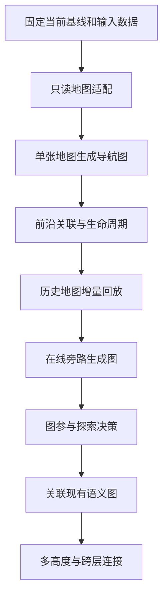

# WildOS 导航图迁移：具体实施步骤与验收清单

日期：2026-11-03  
适用项目：Semantic Navigation / 地下车库无人机探索  
文档状态：实施计划，本文中的新增模块与功能尚未实现。

本文依据 WildOS 论文 Section IV-B、Figure 3、Algorithm 1–5，以及项目中的《WildOS_地下车库无人机适配_逐步实施指南.md》编写。工程接入点来自此前对当前仓库的阅读；正式开发前需要再次核对文件和接口是否变化。

本次交付仅新增本文档。后续按批次实施，每批通过验收后再推进下一批。

## 1. 目标、范围与最终结构

### 1.1 第一阶段要达到什么效果

读取现有探索地图，在已知安全自由空间中生成一张稀疏导航图：

- 节点表示可通行空间中的位置，可以包含无人机尚未到访的位置。
- 自由半径描述节点附近的自由空间范围，用于控制采样密度。
- 探索半径保留历史观测范围的近似信息。
- 前沿关联表示从哪些节点可以继续观察未知区域。
- 边表示经过验证的可通行连接。
- 地图更新后，图能更新旧节点、清除失效边、补充节点和维护前沿。

第一版采用单高度导航图：节点坐标仍为三维 NED 坐标，但采样、前沿和普通连边先在同一飞行高度上处理。高度带和安全约束与当前导航器保持一致。

### 1.2 完整推进顺序



### 1.3 原论文方法与工程适配的区别

| 内容 | 来源与处理方式 |
|---|---|
| 自由半径、探索半径、自由空间采样、前沿节点、安全连边 | 参考 WildOS Algorithm 1–5 |
| 同轮新增节点互相去重 | 工程加强，减少重复采样 |
| 用真实地图状态复核探索半径覆盖 | 车库遮挡场景适配 |
| 旧边失效检查、回环重建后的重新验证 | 当前工程需要补充的生命周期处理 |
| 机体高度带、三维扫掠检查、跨高度执行 | 无人机适配 |
| Object–Place–Region、关系查询、GNN | 后续语义扩展，不属于论文 Algorithm 1–5 |

## 2. 当前项目的接入基础

| 当前文件或模块 | 已核查的职责 | 后续如何使用 |
|---|---|---|
| `application/demo_runtime.py` | 探索模式选用 `mapping/explore_v3` 建图后端 | 确认实际地图来源 |
| `mapping/explore_v3/global_sparse_occupancy_map.py` | 三维稀疏占据地图与快照 | 读取索引、占据证据、分辨率和时间戳 |
| `mapping/explore_v3/online_loop_navigation.py` | 回环地图重建与 revision | 获取一致的地图快照和回环版本 |
| `navigation/route.py` | `NavigationGrid` 高度带投影、同高度连线检查与 A* | 第一版复用安全区域和路径验证 |
| `navigation/utility_frontier_manager.py` | 前沿聚类、视点候选、效用评分和访问记录 | 作为基线，复用合适的数据与规则 |
| `navigation/frontier_geometry.py` | 观察点结构与二维射线信息增益近似 | 第一版保持评分条件一致 |
| `navigation/exploration_planner.py` | 探索决策接口 | 后续输出位置、Yaw、分数和来源 |
| `navigation/frontier_explorer.py` | 探索循环、失败处理与执行衔接 | 接管决策阶段再增加策略切换 |
| `navigation/scene_memory.py` | Object、历史 Place、观测与空间关系 | 后续关联导航图 |

注意：当前 `ExplorationPlanner` 虽然已有接口，但 `FrontierExplorer` 还直接访问 manager 的候选、路径、前沿和诊断字段。不能只增加一个 `select_next_waypoint()` 就认为接入完成。

## 3. 目录约定（按实际实现更新）

所有 WildOS 功能和命令入口统一位于 `exploration_wildos/`。当前静态功能采用下列实际目录；后续增量功能也在该包内扩展。

```text
exploration_wildos/             # 功能和入口，不存运行数据
  __main__.py                  # 统一入口
  map_adapter.py               # 地图读取
  static_graph.py              # 距离场、节点、边与静态验证
  graph_export.py              # 图数据与 HTML 导出
  combined_map.py              # 上下地图布局与缩放
  combine_map.py               # 合并页面入口
  build_snapshot_graph.py      # 单张地图构图入口
  make_demo_map.py             # 合成输入入口
  audit_real_map.py            # 真实地图核查入口
tests/
  test_wildos_static_graph.py
data/runs/<run_id>/             # 一次运行的全部数据
  recordings/                  # 传感器记录
  maps/                        # 原始和回环建图产物
  exploration/
    map.html                   # 上探索地图，下导航图，各自缩放
    occupancy_2d.npz
    semantic_map.json
    private/navigation_cache.npz
    navigation_graph/          # 该次运行的图与验收结果
      graph.json
      graph.html
      validation.json
      audit.json
```

每次运行的地图、图结构和验证数据统一放在 `data/runs/<run_id>/` 内，禁止再将该次图数据分散存到 `reports/`。同一探索的图输出在 `exploration/navigation_graph/`；展示统一通过 `exploration/map.html`。原始地图与日志不覆盖，合并页面前保留原页面备份。合成示例放在 `data/wildos_examples/`，开发基线备份放在 `data/wildos_backups/`。

探索完成后统一执行：`python -m exploration_wildos --exploration-dir data/runs/<run_id>/exploration`。后文未实现的模块名称仅代表职责，实施时同样归入本包。

## 4. 步骤一：固定基线与选择输入数据

### 输入

当前工作区、探索配置、已有地图及传感器或探索记录。

### 具体操作

1. 记录当前提交号、未提交改动、运行入口和实际配置。
2. 保存可恢复的工作区副本或补丁；现有未提交改动必须完整保留。独立工作副本应包含需要沿用的当前改动，不能只复制提交版本。
3. 记录地图来源、分辨率、NED 坐标、飞行高度、水平净空和垂直机体范围。
4. 选择普通车道、遮挡转角、死胡同三类输入；若现有记录不足，明确缺少的场景。
5. 检查数据能否重建地图前缀。最终完整地图可用于静态检查，但不能代替增量探索输入。
6. 如只有传感器记录，先使用既有建图逻辑离线回放生成前缀；如没有足够记录，先完成静态图验证，增量验收保持未完成。
7. 保存当前基线的路径长度、探索耗时、已知区域增长、失败航点和切换次数；缺失指标标记为未记录。

### 产物

- 基线版本及配置清单。
- 输入数据目录、格式、时间范围与坐标说明。
- 可用场景和缺失数据列表。
- 当前探索结果的基线指标。

### 验收

- [ ] 可以说明地图由哪个后端生成。
- [ ] 当前版本及用户已有改动可恢复。
- [ ] 静态地图与增量前缀用途明确。
- [ ] 没有把最终地图提前用于探索决策。

## 5. 步骤二：建立只读地图适配器

### 输入

实际探索后端的全局地图快照；需要对齐在线行为时，同时输入同一时段的局部地图快照、当前位置和配置。

### 具体操作

1. 定义统一快照元信息：`snapshot_id`、时间戳、回环 `revision`、分辨率、坐标系和高度带。
2. 对全局体素按阈值分类：达到自由阈值为 FREE，达到占据阈值为 OCCUPIED，中间状态及缺失体素按 UNKNOWN 处理。开发时检查阈值顺序及边界一致性。
3. 复用 `NavigationGrid.from_global()` 的高度带规则生成单高度表示。
4. 分别保留原始自由区域和安全自由区域。原始自由区域用于前沿与距离场；安全自由区域用于节点和边验证。
5. 若融合局部地图，沿用当前对时间新鲜度、局部障碍否决、完整体积自由证据的规则。
6. 提供世界坐标与体素/网格索引转换，处理负坐标、网格边界和 NED 高度方向。
7. 规定地图外部一律为未知。距离场计算范围需要包含已知区域周围的未知边界。
8. 对快照数据使用只读访问或必要复制，避免并发读取过程中混合不同地图版本。

### 产物

`map_adapter.py`、统一快照结构，以及状态与坐标转换验证结果。

### 验收

- [ ] 缺失体素不会被视为 FREE。
- [ ] 中间占据证据不会被自动视为 FREE。
- [ ] 同一位置的安全判定与现有导航网格一致。
- [ ] 坐标往返转换在允许的离散误差内正确。
- [ ] 不重复扣除已经用于自由区域收缩的机体安全半径。

## 6. 步骤三：计算距离场并定义图结构

### 输入

单高度原始自由区域、障碍区域、未知区域及安全配置。

### 具体操作

1. 在有界地图窗口中计算到障碍和未知区域的距离 `D_obs`、`D_unk`。
2. 定义距离是到体素中心还是体素边界；如采用中心距离，需要处理离散网格带来的净空高估，不能直接作为无碰撞证明。
3. 第一版使用离线距离变换；大范围地图采用分块或局部窗口，记录内存与耗时。
4. 节点自由半径采用 `min(D_obs, D_unk, free_radius_cap)`。
5. 探索半径参考论文保存历史最大未知距离，同时注明它是几何近似，不是完整的可见性证明。
6. 建立独立节点 ID、边 ID 和前沿 ID，避免与现有语义 Place 编号冲突。
7. 区分回环版本与普通观测更新序号；每条验证结果标明依据的快照。

### 建议字段

| 数据 | 字段 |
|---|---|
| 节点 | `id, position_ned, free_radius, explored_radius, frontier_ids, valid, created_snapshot, validated_snapshot` |
| 边 | `id, source, target, length, valid, validated_snapshot, invalid_reason` |
| 前沿簇 | `id, boundary_cells, anchor_node_ids, valid, last_seen_snapshot` |
| 图元信息 | `schema_version, frame, altitude, map_revision, snapshot_id, random_seed, config` |

### 验收

- [ ] 距离单位与地图单位一致。
- [ ] 空障碍集合、空自由集合及地图边缘均有明确处理。
- [ ] 图可保存并重新加载，字段含义不丢失。
- [ ] 回环 revision 没变化时，仍能识别新的占据观测。

## 7. 步骤四：采样节点并构建安全边

### 输入

地图适配器、距离场、图结构和采样配置。

### 具体操作

1. 从安全自由区域采样候选点，固定随机种子以便回放比较。
2. 检查候选点是否满足当前高度、安全区域和地图范围要求。
3. 若候选点落入已有节点的自由半径覆盖范围，按去重规则拒绝。
4. 同时检查本轮已接受的新节点，避免同轮重复采样。
5. 将当前位置映射到附近安全节点；没有合法连接时明确报告机器人未接入图，不能强行连边。
6. 对窄道、转角和未覆盖自由区域执行有界补充采样。
7. 在连接半径内搜索节点对，使用现有同高度 `segment_free()` 检查整条连接。
8. 保存边长和验证快照，去除重复边与自环。
9. 计算连通分量；分别显示当前可达分量和其他分量。
10. 导出节点、半径、有效边、障碍和未知区域。

### 产物

单张地图导航图 JSON、可视化、采样拒绝原因和连通分量统计。

### 验收

- [ ] 有效节点全部处于安全自由区域。
- [ ] 有效边通过现有线段安全检查。
- [ ] 边不会穿过墙、车辆、柱子或未知区域。
- [ ] A* 可达但图不连通的案例有记录，用于定位采样不足或连接半径问题。
- [ ] 固定种子、输入和配置能重现相同结果。

## 8. 步骤五：提取前沿并关联导航节点

### 输入

原始自由/未知边界、当前导航图、现有前沿聚类规则。

### 具体操作

1. 第一版沿用现有二维前沿定义及邻域规则，保持基线可比较。
2. 对边界单元聚类并过滤噪声；记录过滤依据。
3. 对每个前沿簇寻找附近安全节点，建立可观察或可接近的关联。
4. 分开实现前沿关联检查与飞行边检查：前沿是观察目标，安全导航节点才是运动位置。
5. 关联检查必须考虑已知障碍遮挡；不能仅按欧氏距离把墙两侧关联起来。
6. 节点存在有效关联时标记为前沿节点；关联清空后恢复普通节点。
7. 前沿清理以真实地图状态为依据。探索半径只能用于候选筛选，不能单独决定被遮挡区域已经探索完成。
8. 地方性地图暂时不可见不等于全局前沿已失效，记录保留或失效的原因。

### 产物

前沿簇、节点关联、无关联前沿列表及原因，可视化中区分普通节点与前沿节点。

### 验收

- [ ] 未知区域被观测后，相关前沿能更新或消失。
- [ ] 车辆后方的未知区域能继续保留。
- [ ] 墙两侧不会产生缺乏证据的观察关联。
- [ ] 没有可关联节点的前沿被明确记录，不被静默删除。

## 9. 步骤六：增量更新与历史回放

### 输入

按时间排序的地图前缀、对应位姿与回环版本。

### 每轮执行顺序

1. 读取一致的新快照，判断普通观测变化还是回环重建。
2. 更新可验证范围内旧节点的自由半径、探索半径和有效性。
3. 节点不安全时禁用节点及其连接。
4. 对受影响的旧边重新检查；第一版可全量验证，优化前先保证正确。
5. 在新增或覆盖不足的自由区域采样节点。
6. 更新前沿、关联和节点前沿标志。
7. 构建新增安全边，更新连通分量和机器人接入位置。
8. 导出当前图、变化列表和更新时间。

### 回环重建处理

回环地图重建时，第一版完整重新验证图。如果旧节点坐标无法可靠对应重建后的空间，重新生成受影响图结构并记录 ID 映射或失效记录；不能只修改版本号后继续使用原边。

### 产物

`wildos_replay_graph.py`、逐帧图或图变化记录、性能统计与失败案例。

### 验收

- [ ] 不受影响的旧节点 ID 稳定。
- [ ] 新障碍使旧边及时失效，即使两个端点仍然安全。
- [ ] 历史可通行分支可以保留，局部视野移动不会清空全局图。
- [ ] 回环后不存在未验证却被标记为有效的连接。
- [ ] 空地图、断连图、前沿耗尽和数据中断均能输出明确状态。

## 10. 步骤七：在线旁路运行

### 前提

静态安全验证和增量回放已经通过。

### 具体操作

1. 增加可选的图更新任务，读取运行时地图快照。
2. 图任务独立于控制循环，设置更新频率、时间预算和有界队列；积压时优先处理最新完整快照。
3. 当前探索器继续选择航点，图模块仅生成记录和可视化。
4. 记录图更新时间、队列延迟、节点/边规模、失效原因和地图版本。
5. 对抽样候选比较图连通性与现有 A* 可达性，保存差异案例。
6. 检查图更新是否影响地图心跳、规划等待和控制循环时序。
7. 图任务异常时记录错误并关闭旁路功能，不把异常伪装成探索完成。

### 产物

实时图记录、性能报告、图与 A* 判断差异列表。

### 验收

- [ ] 旁路图不会向执行器发送航点。
- [ ] 没有因图更新造成持续地图积压或控制延迟。
- [ ] 在线图与相同输入的离线结果差异可以解释。
- [ ] 停用旁路开关后可以恢复基线运行流程。

## 11. 步骤八：接入探索候选与执行结果反馈

### 前提

在线旁路稳定，主要可达性差异已查明。

### 具体操作

1. 增加 `utility` 与 `wildos_graph` 策略选项，保留基线入口。
2. 盘点 `FrontierExplorer` 对 manager 的所有访问：候选、路径、评分、前沿簇、失败记录、诊断和批处理状态。
3. 定义共同候选结构与状态接口，适配 ID、访问记录、失败冷却和完成判定。
4. 从机器人所在连通分量中提取前沿节点。
5. 围绕其关联前沿生成安全观察位置和 Yaw；视点可以不同于导航节点本身。
6. 复用现有 A* 验证候选并计算实际路径代价，保留失败原因。
7. 第一版沿用信息增益、路径、转向和重访评分；前方走廊优先规则在对照组中保持一致。
8. 输出 `position, yaw, score, source`，交由当前执行链路处理。
9. 到达、受阻或失效后更新访问与失败记录；普通观测更新不应无条件打断当前航点。
10. 前沿暂时断连、候选批次未处理完和地图滞后，不能直接解释为探索结束。

### 实验对照

| 组别 | 设置 | 用途 |
|---|---|---|
| A | 当前探索策略 | 基线 |
| B | 图组织候选，尽量沿用同样评分和选择规则 | 检查图结构与记忆的作用 |
| C，后续 | 同一导航图和候选，改变评分函数 | 检查语义或视觉评分的作用 |

比较路径长度、目标发现时间、重复访问、失败航点、切换次数、碰撞/制动事件和决策耗时。固定场景和预算，使用多个种子；不凭单次演示判断改进。

### 验收

- [ ] 能完成普通车道、遮挡转角和死胡同场景的闭环运行。
- [ ] 执行前候选经过当前规划器验证。
- [ ] 失败反馈能更新图探索状态，避免反复选择同一失败候选。
- [ ] 图不完整与真实前沿耗尽有不同的终止原因。
- [ ] 可以通过配置切回原策略。

## 12. 步骤九：关联语义图与目标查询

### 具体操作

1. 保留历史到访 Place 的轨迹与观测含义，导航节点使用独立 ID。
2. 为 Object 建立可观察或可接近的导航节点关联，保存依据和时间。
3. 区分 `observed_at`、空间邻近、可观察关系和 `traversable_to`，避免把语义边用于运动规划。
4. 已知目标：查询实例，选择目标附近安全观察点，通过现有导航链路执行。
5. 未知目标：先使用可解释的对象或区域先验调整前沿分数，记录每项贡献。
6. 实例合并、编号变化时更新引用；图重建时清理失效导航节点引用。
7. 对“后方”等关系明确参考系。当前基于初始朝向的方向关系不能直接解释为 SUV 自身朝向下的后方。
8. Region 和 GNN 作为独立后续任务，先建立规则基线及缺失证据状态。

### 验收

- [ ] 实例与导航节点关联可以追溯到观测或几何依据。
- [ ] 语义关系边不会被当作可飞行边。
- [ ] 朝向缺失时返回关系未知，不强行给出确定结论。
- [ ] 能分别演示已知目标导航与未知目标继续探索。

## 13. 步骤十：扩展多高度与三维连接

### 前提

单高度图与探索闭环稳定，已有对照结果。

### 具体操作

1. 根据机体尺寸、顶棚、车辆、横梁和允许飞行范围设置多个候选高度层。
2. 每层独立提取安全区域、节点和前沿。
3. 在允许位置寻找跨层节点对。
4. 使用原始三维占据数据检查连接全过程的机体扫掠空间，未知区域同样参与约束。
5. 为跨层连接建立明确的规划与执行支持；当前同高度 A* 不能直接承担任意三维边。
6. 将信息增益从二维水平射线扩展为结合相机内外参的三维视锥估计。
7. 检查不同高度对同一未知区域的重复计数，以及高度切换的路径和时间代价。
8. 在横梁、车顶、坡道等场景分别验证后，再考虑更自由的三维采样。

### 验收

- [ ] 跨层边的每个中间位置均有足够安全证据。
- [ ] 三维图中的边具有对应可执行路径。
- [ ] 高度变化不会造成顶部碰撞或无效反复切层。
- [ ] 多高度版本相对单高度版本的收益和额外开销均有记录。

## 14. 配置与性能记录

所有数值在读取当前地图与机体配置后确定。论文的采样数、半径和距离不能直接作为无人机默认值。

| 参数 | 如何确定 |
|---|---|
| 飞行高度与高度带 | 复用当前导航配置，并记录 NED 约定 |
| 机体半径和安全裕度 | 使用当前安全模型，检查是否已作用于网格 |
| 自由半径上限 | 在节点数量、窄道覆盖和连通性之间测试 |
| 边连接半径 | 与采样密度共同调整，用 A* 可达性对照 |
| 每轮采样数 | 受更新预算约束，记录覆盖不足区域 |
| 图更新频率 | 根据快照生成速度和实际耗时确定 |
| 前沿最小簇 | 第一版沿用基线，再单独消融 |
| 完成与失败条件 | 延续现有预算、失败冷却和覆盖复查逻辑 |

每轮至少记录：`snapshot_id`、回环版本、更新时间、节点和边数量、失效数量、连通分量、前沿数量、无关联前沿数量、候选数量、A* 调用数、失败原因和最终选择。

## 15. 分批执行与每批交付

| 批次 | 对应步骤 | 具体成果 | 进入下一批的条件 |
|---|---|---|---|
| A | 步骤一至四 | 基线清单、地图适配、静态导航图、可视化 | 节点与连边安全，坐标一致 |
| B | 步骤五至六 | 前沿生命周期、增量回放 | 旧节点/边更新正确，回环可处理 |
| C | 步骤七 | 在线旁路图和性能报告 | 无持续积压，差异可解释 |
| D | 步骤八 | 图探索策略与对照结果 | 闭环可运行，失败和终止状态正确 |
| E | 步骤九 | 对象关联与目标查询 | 语义和运动关系明确，证据可追溯 |
| F | 步骤十 | 多高度图与跨层执行 | 三维安全和执行能力验证通过 |

每批交付应包括：

1. 新增与修改文件清单。
2. 实际接入接口和数据格式。
3. 经过验证的运行命令与依赖说明。
4. 有针对性的测试或场景验证结果。
5. 可视化、统计和失败案例。
6. 已完成、未完成及阻塞事项。
7. 停用新功能或恢复基线的方法。

## 16. 第一批可以直接执行的任务清单

- [ ] 保存当前版本信息及已有改动。
- [ ] 找到一份可读取的实际探索地图并记录来源。
- [ ] 核对地图坐标、阈值、分辨率和导航高度带。
- [ ] 实现只读地图适配器。
- [ ] 在有界区域计算障碍与未知距离。
- [ ] 实现节点结构、确定性采样和同轮去重。
- [ ] 实现同高度安全连边与连通分量检查。
- [ ] 导出图 JSON 和可视化。
- [ ] 验证墙、柱子、车辆和未知边界附近的节点与边。
- [ ] 提交实际运行结果及下一批待解决问题。

第一批完成标准：能够指出地图中每个有效节点为什么安全、每条边通过了什么检查，以及哪些自由区域尚未被图正确覆盖。第一批不以飞行效果作为完成条件。
