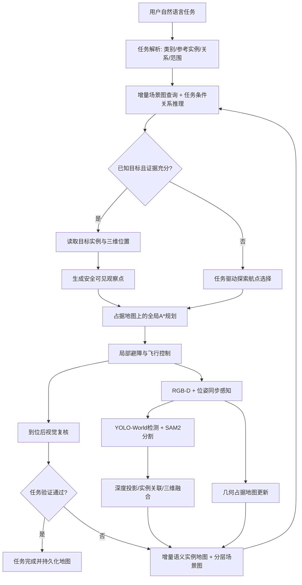
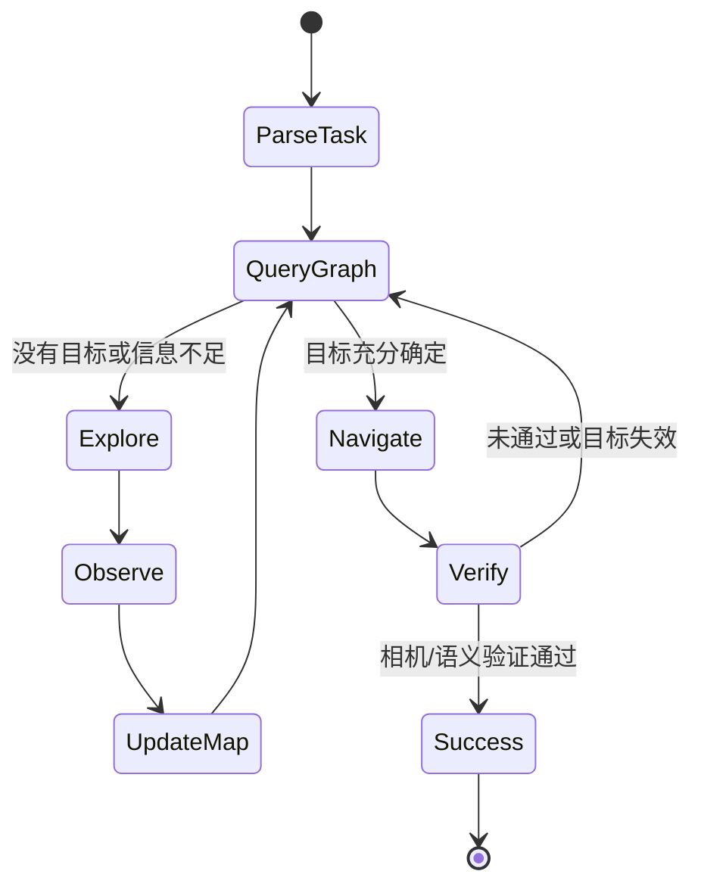

# 面向未知地下车库的无人机增量语义认知与任务驱动导航技术路线及实施方案

> 版本：V1.0（2026-10-12）  
> 定位：研究设计与工程实施方案；将**当前模块打通**与**后续研究目标**明确分开。  
> 核心目标：无人机在未知地下车库中按任务探索，持续构建可复用的三维几何地图和增量语义场景图；接到新自然语言任务时先查询历史知识，若证据充分则导航，否则围绕任务继续探索并更新地图。

## 1. 研究目标与边界

### 1.1 当前阶段（V1）

1. 无人机自主探索未知地下车库，采集同步 RGB、深度、位姿。
2. 检测和分割指定类别：轿车、SUV、消防箱、安全出口、限速标志等。
3. 结合深度和位姿恢复实例三维位置，融合重复观测，构建三维占据体素地图和语义实例地图。
4. 保存/加载地图；探索结束后按类别、区域、距离查询物体并导航至安全观察点。
5. 完成探索、感知、建图、查询、规划、控制的端到端模块闭环。

### 1.2 后续阶段（V2–V3）

- **V2 语义认知**：建立分层异构场景图，支持多关系自然语言查询；引入 GNN 进行任务条件节点匹配、缺失/噪声关系下的候选排序；仍保留确定性图查询作为基线。
- **V3 任务驱动探索**：无需先完成全图探索。用户直接提出目标；系统优先查询已有地图，若目标不存在、参考物体未知或证据不足，生成有价值的探索航点；持续更新语义图、重试查询，发现目标后转入导航与验证。

### 1.3 非目标与重要约束

- GNN **不替代** 现有 A* 路径规划及局部避障模块，不直接承担飞控安全闭环。
- 不是所有自然语言查询都需要 GNN。类别查询、欧氏距离、确定的拓扑关系优先使用几何/规则求解。
- **未观测 ≠ 不存在**；“当前已知目标最近”不意味着“全环境全局最近”。
- “位于 SUV 后方”必须明确坐标系与 SUV 朝向；缺失朝向时返回歧义/需要补充观测，而不能虚构关系。
- 完整探索定义为达到可量化覆盖及地图质量阈值，而非假设每个隐藏目标已被观察。

## 2. 总体系统架构



系统既允许 **V1：先全图探索→离线查询→导航**，也允许 **V3：给定任务→查询→补充探索→导航**；两者共用感知、建图、规划与飞控接口。

## 3. 分层地图设计

### 3.1 几何层（Geometry / Occupancy）

- 输入：深度图、相机内参、机体/相机外参、世界位姿；考虑有效深度范围和测量置信度。
- 输出：稀疏三维体素占据/空闲/未知；用于碰撞检查、通行性评估、全局规划、观察点验证。
- 要求：地图坐标系统一（例如 NED），明确相机到世界坐标变换；使用适当障碍膨胀与 UAV 尺寸裕量。

### 3.2 语义实例层（Object Instances）

- 输入：YOLO-World 检测框、类别/置信度，SAM2 实例掩膜、深度和位姿。
- 输出：稳定实例 ID、类别、三维位置及协方差/置信度、包围盒、可见视角、时间戳、观测次数、可选视觉描述向量。
- 重复观测融合：同类候选筛选→空间门控→掩膜/三维包围盒/外观一致性→数据关联→融合更新；维护身份冲突与错误关联日志。
- 类别文本提示可以灵活扩展，但开放词汇检测不保证罕见目标可靠，需独立评价漏检和误检。

### 3.3 场景图层（Hierarchical Heterogeneous Scene Graph）

**节点**：物体实例（object）、空间区域（region）、拓扑通行节点（connector，可选）、无人机当前位置（agent，可动态查询而非长期固定节点）。

**边**：`inside`（区域包含）、`near`（距离阈值及可选尺度归一化）、`connected_to`（可通行拓扑）、`left_of/right_of/behind`（明确参考系）、`observed_from`（可选）。

**关系状态**：`true / false / unknown`，同时保存证据来源、时间戳和置信度。关系可以是方向性的；不要默认所有边都无向。

建议同时保留：

1. **显式事实图**：几何/拓扑可核实的事实，可解释、可直接检索。
2. **学习型表示**：GNN 节点嵌入和任务相关分数，只作为辅助推理，不覆盖原始测量。

### 3.4 地图持久化

建议地图版本包含 `map_id`、坐标系、体素分辨率、时间戳、感知模型版本、类别词表、实例表、区域表、边表、拓扑图与可选特征缓存。对新一轮任务优先**加载历史地图并继续增量更新**，而不是重新建空图。

## 4. 自然语言任务接口与查询机制

### 4.1 任务解析为结构化约束

输入：`找到离安全出口最近、位于 SUV 后方的消防箱`。

示例：

```json
{
  "intent": "find_object",
  "target_class": "fire_cabinet",
  "constraints": [
    {"relation": "behind", "reference_class": "SUV", "reference_frame": "vehicle_heading"}
  ],
  "ranking": {"criterion": "distance_to_nearest", "reference_class": "emergency_exit"},
  "on_insufficient_evidence": "explore"
}
```

“最近”应定义为欧氏距离、可通行路径距离还是其他代价；`behind` 必须区分车辆自身朝向与观察者视角。涉及多个 SUV 或出口时，任务解析需明确是“任一参考实例”“指定实例”还是“最近参考实例”，必要时询问用户。

### 4.2 查询执行链

1. 按类别筛选已知消防箱候选。
2. 查找满足朝向已知且 `behind` 关系可信的 SUV 参考实例。
3. 按约束筛选候选；对于关系未知的候选保持未决状态。
4. 根据已知出口计算距离或导航代价并排序。
5. 检查证据充分性与地图覆盖条件。
6. 若可信 → 输出目标 ID、位置、证据；否则 → 输出缺失信息需求并触发探索。

**输出契约**：

```json
{
  "status": "resolved",
  "target_id": "fire_cabinet_03",
  "position_world": [12.5, 8.1, -1.4],
  "map_frame": "NED",
  "score": 0.91,
  "evidence": ["behind_suv_02", "near_exit_01"],
  "requires_visual_confirmation": true
}
```

或者 `status: unresolved`，包含 `reason`、`missing_evidence`、`suggested_exploration_regions`。上面位置和得分均为接口示例，不是实验结果。

## 5. GNN 模块设计与训练

### 5.1 为什么使用 GNN

对于已知类别与确定性空间关系，规则图查询足够。GNN 研究重点应放在**多关系组合、噪声关系、部分可观测环境和未见布局下的候选匹配**。必须和规则查询基线比较，验证是否具有实际收益。

### 5.2 输入输出

- 输入：当前图 `G_t=(V_t,E_t)`、节点特征 `X_t`、关系类型/边特征、任务向量 `z_q`。
- 节点特征：类别嵌入、位置（建议用相对/归一化位置）、尺寸、置信度、视觉语义特征；区域节点使用其专属属性与类型编码。
- 输出一：`H_t = GNN(G_t,X_t)`，每节点 `d` 维嵌入。
- 输出二：对候选节点的任务匹配分数 `s_i = MLP([h_i || z_q || g_i])`，其中 `g_i` 可包含显式几何关系特征。
- 输出三（可选）：关系预测得分、`unknown / need_more_observation` 判定。位置由地图读取，不要求 GNN 重新回归已测得的三维坐标。

网络从两层 GraphSAGE/GAT 原型开始；对于 `object/region/connector` 异构节点及多关系边，可升级 R-GCN/HeteroGNN/带边特征的注意力网络。

### 5.3 训练数据构建（优先使用仿真）

每条训练样本：`(scene_graph, query, candidate_ids, label, observability_metadata)`。

1. 在 UE 地下车库中变化车辆布局、消防设施、出口、区域和障碍物。
2. 利用仿真真值生成完整图及可验证的目标标签；自然语言模板改写为多样句式。
3. 重放 UAV 实际视角轨迹，生成局部/不完整图，加入漏检、误检、位姿扰动、关系未知等现实误差。
4. 标签根据**当前证据可判定性**区分 `target_id`、`multiple_valid`、`unknown`，而不把未观察对象视作不存在。
5. 按**场景布局**划分训练/验证/测试，避免同一张图的不同问句落入不同集合造成泄漏。
6. 加入困难负样本：距离接近但不同区域、不连通区域、朝向相反、多个相似消防箱。

### 5.4 损失函数

对于单正确目标且证据充分的任务：

\[
P(v_i\mid G,q)=\frac{\exp(s_i)}{\sum_{j\in C(q)}\exp(s_j)},\qquad
\mathcal L_{\mathrm{target}}=-\log P(v_y\mid G,q)
\]

证据不足样本增加 `unknown` 分类/拒识分支。可选关系监督：

\[
\mathcal L=\mathcal L_{\mathrm{target}}+\lambda_u\mathcal L_{\mathrm{unknown}}+\lambda_r\mathcal L_{\mathrm{rel}}
\]

注意关系预测时，待预测边不能以真实标签原样输入模型（避免标签泄漏）。第一轮实验先设置 `lambda_r=0`，跑通目标匹配后再做辅助监督消融。对多正确目标需改为多标签或集合监督，不能直接沿用唯一目标交叉熵。

### 5.5 训练与推理流程

```python
# 训练伪代码，省略批处理与异构图细节
for graph, query, candidates, label in loader:
    H = gnn(graph)
    z = query_encoder(query)        # 第一版可用结构化任务编码
    scores = matcher(H[candidates], z)
    loss = target_or_unknown_loss(scores, label)
    optimizer.zero_grad()
    loss.backward()
    optimizer.step()

# 部署时只加载训练好的参数并前向推理；新发现节点不要求重新训练
```

初期可冻结文本编码器，先用结构化任务编码；后期再引入 LLM/语言编码器。部署时保持特征定义、关系词表与训练一致；开放集新类别需要单独验证泛化。

## 6. 任务驱动探索闭环（V3）

### 6.1 状态机



### 6.2 探索航点评分（建议性设计）

在已有 frontier/utility/FUEL 等探索航点生成器之上加入任务相关评分，而不是更换底层避障器：

\[
U(p)=w_I I(p)+w_S S(p,q)-w_C C(p)-w_R R(p)
\]

- `I(p)`：预期未知空间信息增益。
- `S(p,q)`：任务相关语义线索，例如靠近可能存在目标的区域。
- `C(p)`：规划路径长度/时间代价。
- `R(p)`：安全风险或重复观测代价。

上式是**拟议算法**，不是所上传论文的原始公式。必须先实现 `S=0` 的常规探索基线，再比较加入语义线索后的效果。GNN 可以为候选区域生成分数，但不要把其分数当作真实目标存在概率，除非经过校准。

### 6.3 停止与失败条件

- 已找到目标，安全观察点可到达，最终视觉验证通过 → 完成。
- 地图覆盖达到阈值但目标仍未找到 → 报告未发现，不能断言目标不存在。
- 多目标任务证据不足 → 继续探索或询问用户澄清。
- 超时、能量不足、地图冲突、定位异常 → 安全终止并保存状态。

## 7. 与现有系统模块对接

| 模块 | 输入 | 输出 | 本方案角色 |
|---|---|---|---|
| RGB-D + 位姿 | 传感器与 PX4 状态 | 时间同步观测 | 原有模块复用 |
| YOLO-World | RGB + 文本类别 | 检测框、类别、置信度 | 语义识别 |
| SAM2 | RGB + 目标框 | 实例掩膜 | 精细分割 |
| 3D 投影/实例融合 | 深度、掩膜、位姿 | 实例三维属性与 ID | 增量建图 |
| Occupancy Map | 点云、位姿 | 占据/空闲/未知 | 规划与安全 |
| Scene Graph（新增） | 实例、区域、拓扑 | 图节点、边、证据 | 语义查询与推理 |
| Query Parser（新增） | 自然语言 | 结构化约束 | 任务理解 |
| GNN（V2 新增） | 当前图 + 任务 | 节点匹配分数、未知状态 | 复杂关系推理 |
| 探索航点生成器 | 未知区域 + 任务线索 | 候选探索航点 | V1 常规探索、V3 任务引导 |
| A* + 局部避障 + PX4 | 航点与几何地图 | 安全飞行 | 现有底层保留 |

建议约定公共接口：`observe()`, `update_occupancy()`, `upsert_instance()`, `update_scene_graph()`, `parse_query()`, `resolve_query()`, `select_exploration_goal()`, `plan_to_viewpoint()`, `verify_target()`。接口形式可以是 Python 对象、JSON/消息总线；关键是统一 `instance_id`、坐标系和时间戳。

## 8. 分阶段实施计划与验收标准

### V1：先探索、后查询、再导航（当前开发阶段）

- [ ] RGB-D、深度投影和 PX4 世界坐标一致性测试。
- [ ] YOLO-World + SAM2 目标检测与掩膜到三维点云映射。
- [ ] 跨帧实例关联与同一目标去重。
- [ ] 占据体素地图、语义实例 JSON/数据库保存与恢复。
- [ ] 探索停止条件：可探索 frontier 耗尽或达到覆盖/时间/安全阈值。
- [ ] 基础任务：`找某类物体`、`找最近实例`、`到达某目标附近`。
- [ ] 观察点碰撞检测、可见性检查和到达后再识别确认。

**验收**：重启加载地图后无需重新探索即可定位已保存实例并完成规划导航；记录检测准确率、实例定位误差、重复实例率、查询成功率、导航成功率与耗时。

### V2：分层图 + 自然语言复杂关系查询

- [ ] 建立 `object-region-connector` 场景图与关系证据状态。
- [ ] 解析 `near / behind / inside / connected_to / nearest` 等约束。
- [ ] 确定性规则图查询实现为基线。
- [ ] 生成 UE 场景图—文本—目标标签训练集。
- [ ] 训练 MLP、GAT/GraphSAGE、异构 GNN 等对比模型。
- [ ] 支持未决关系及 `unknown` 预测与置信度校准。

**验收**：在未见过的车库布局上评估复杂关系查询 Top-1、Recall@K、误匹配率、未知判断质量、推理延时。

### V3：先查询、再任务驱动探索的在线闭环

- [ ] 新任务优先查已有地图，目标可信时直接导航。
- [ ] 未知时触发探索，地图/图增量更新后重新查询。
- [ ] 从语义线索生成候选区域评分并与原探索方法比较。
- [ ] 支持多个连续任务与地图知识复用。
- [ ] 处理目标未发现、同类多实例、遮挡、误识别、动态车辆、无法到达等情况。

**验收**：对比盲探索、纯几何查询和任务驱动探索，统计任务成功率、总搜索时间、探索距离、重复探索率、已知地图复用收益、安全事件率。

## 9. 实验方案与消融设计

### 9.1 场景划分

- 多种地下车库布局（车位密度、车辆排列、转角/岔路、视线遮挡、出口位置）。
- 训练、验证、测试按**布局或车库实例**划分；部分场景可加入语义类别组合变化。
- 仿真阶段用真值构造监督标签；测试阶段以机载感知地图为输入，防止真值泄漏。

### 9.2 必要基线

1. **Rule-only**：类别/位置/关系规则图查询，不用 GNN。
2. **MLP-only**：节点单独评分，无图消息传递。
3. **GNN-full-map**：完整图训练、完整图测试。
4. **GNN-partial-map**：部分图及噪声训练，在增量图上测试。
5. **Blind exploration** vs **Task-aware exploration**：在同一规划与避障配置下比较。

### 9.3 指标

- 感知/建图：类别精度与召回、实例跟踪 ID 一致性、3D 定位误差、地图覆盖率、几何地图误差。
- 图推理：Top-1、Recall@K、复杂约束满足率、开放/未知样本拒识精度、ECE 校准误差、推理延时。
- 导航：SR、SPL（适用时）、搜索时长、飞行距离、碰撞次数、重复探索区域比例、任务切换后知识复用率。
- 资源：CPU/GPU 占用、显存峰值、图节点数增加时的延时与内存曲线。

### 9.4 关键消融

- 无区域层 / 有区域层；仅几何边 / 几何+拓扑边 / +语义关联边。
- 固定规则权重 / 学习型 GNN 权重；完整图训练 / 部分图训练。
- 无视觉嵌入 / 加 YOLO-World 区域嵌入。
- 无 unknown 状态 / 有 unknown 状态。
- 纯 frontier 信息增益 / 加任务条件区域评分。

## 10. 技术风险与处理办法

| 风险 | 后果 | 应对 |
|---|---|---|
| 重复识别/错误关联 | 同一实例产生多个节点 | 跨帧关联、融合门控、人工检查工具 |
| 深度与位姿不同步 | 物体位置漂移 | 时间戳对齐、外参标定、误差/协方差传播 |
| 回环校正后图失配 | 图节点位置与几何地图不一致 | 实例绑定关键帧或支持全局重投影/批量更新 |
| `behind` 语义歧义 | 查询结果不稳定 | 明确坐标系、记录朝向质量、必要时追问 |
| 未知区域被当作无目标 | 提前结束搜索 | 三态关系、覆盖证据、unknown 分支 |
| GNN 学到纯距离捷径 | 图关系模块缺乏贡献 | 加入复杂约束、困难负样本、规则基线 |
| 全连接图规模过大 | 推理成本高 | 区域分层、稀疏候选边、邻居采样 |
| 动态车辆影响地图 | 历史语义过期 | 静态/动态节点区分、时间衰减、到位复核 |
| 探索与安全冲突 | 风险增大 | 底层规划/避障独立约束，语义策略只给航点 |

## 11. 推荐项目目录（示意）

```text
Semantic-Navigation/
├── sensors/                 # RGB-D + pose
├── detections/              # YOLO-World + SAM2
├── mapping/                 # voxel, semantic instances, loop closure
├── scene_graph/             # 新增：graph builder, relations, persistence
├── reasoning/               # 新增：query parser, rule query, GNN ranking
├── exploration/             # 现有航点选择 + task-aware scoring
├── mission/                 # 任务状态机/执行调度
├── planner/                 # A*, local avoidance
├── vehicle/                 # PX4 / RflySim 接口
├── datasets/                # 场景图和任务查询样本
├── training/                # GNN 训练、评估和配置
└── tests/                   # 模块级、仿真级与闭环测试
```

## 12. 与参考论文的关系

参考：Meng 等，*Context-Aware Graph Inference and Generative Adversarial Imitation Learning for Object-Goal Navigation in Unfamiliar Environment*，IEEE RA-L，2025，DOI: 10.1109/LRA.2025.3546860。

**论文原有方案**：第一人称 RGB → DETR 物体特征与全连接图 → 图像/动作/记忆上下文的 TransH 关系权重 → GAT → 与视觉特征融合 → LSTM + A3C 动作策略；GAIL 辅助学习导航奖励。

**本项目借鉴部分**：上下文相关边权学习和图注意力表示。

**本项目拟议扩展（不是论文原有方法）**：持久化 RGB-D 三维地图、分层异构场景图、自然语言组合约束、目标实例监督匹配、未知状态管理、任务驱动增量探索以及与独立规划控制模块耦合。不要把这些内容表述为原论文已经验证的结论。

## 13. 下一步最小可执行清单

1. 固定世界坐标系、实例数据结构和地图保存格式。
2. 完成“同一消防箱多视角识别 → 唯一实例 ID → 保存/加载”。
3. 实现 `find_by_class`、`nearest_to`、`inside_region` 三个确定性查询 API。
4. 实现 “目标实例 → 安全观察点 → A* → 飞行 → 视觉验证” 闭环。
5. 在地图上增加 `object-region` 关系，导出第一版图数据。
6. 收集多车库场景数据，生成复杂关系任务与目标标签。
7. 完成 Rule-only 与 MLP 基线后再训练 GNN。
8. 最后把“查不到目标→探索→更新图→重查”接成任务状态机。

---

**一句话总路线**：先构建稳定、可保存、可查询的三维语义地图；再增量组织为可解释的分层场景图；之后训练 GNN 学习复杂任务下的候选目标匹配；最后把查询结果与任务驱动探索相结合，形成未知地下车库中的持续语义导航闭环。
